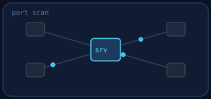
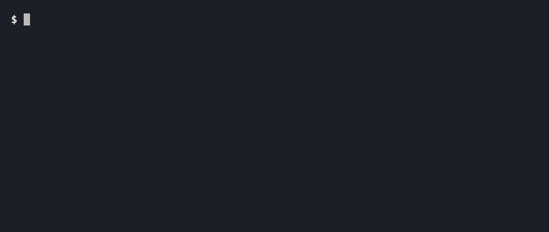
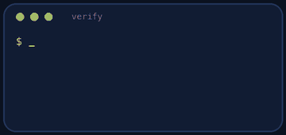
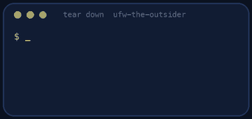
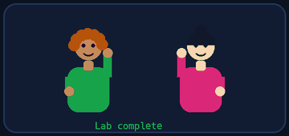

<p align="center"></p>

| | |
|-|-|
| **Time** | 45-60 min |
| **Cost** | free |
| **You need** | Your Ubuntu environment (WSL or OrbStack machine) with sudo |

## How this lab works

1. **Fork** this repository to your own GitHub account (button at the top right).
2. Clone **your fork** in your Ubuntu environment (WSL on Windows, your OrbStack machine on Mac).
3. Read the lab below (the same text is in [`LAB.md`](LAB.md)) and follow the mission.
4. Answer the questions in [`SUBMISSION.md`](SUBMISSION.md). Where a question asks for output, paste it in a code block. No screenshots needed.
5. Commit and push. Open the **Actions** tab of your fork (click *I understand my workflows, go ahead and enable them* the first time). The **Lab check** shows what is still missing.
6. When the check is green, **submit the URL of your fork** in the course platform.

> [!NOTE]
> The check only looks at your answers and any files the lab asks you to commit. Your instructor reads your work and may ask you to explain any line.

<p align="center"></p>

## 🎬 The situation

<p align="center"></p>

Friday, 16:30. The security team ran a port scan against the Clipstr server from the internet and sent you the result with three words: *"Explain. Fix. Today."* The scan found **five open doors**: the web port (fine), an admin shell, the PostgreSQL database, the Redis cache and a metrics endpoint. Only one of those should be public.

Nobody has configured a firewall on this machine. You will, with `ufw`, from the inside, while watching the result from the outside.

> [!IMPORTANT]
> **Your mission**
> - Scan the server like an attacker and see what is exposed
> - Build a policy: **default deny**, then open only what each audience needs
> - Learn what happens to a session that was open **before** the firewall came up
> - Prove the policy from two vantage points: the internet and the office

**Time:** 45-60 min | **Cost:** free | **You need:** your Ubuntu environment with `sudo`. The lab builds two small virtual networks on your machine; `sudo ./teardown.sh` removes them.

<p align="center"></p>

## Part 0 - Set the scene

Fork this repository, clone your fork, and run:

```bash
sudo ./setup.sh
```

You now have three "places": **this machine** is the server (`10.77.0.1` and `10.78.0.1`), `outsider` (`10.77.0.2`) plays the open internet, and `office` (`10.78.0.2`) plays your trusted office. Scripts let you look at the server from each place.

<p align="center"></p>

## Part 1 - Recon: be the attacker

<p align="center"></p>

```bash
sudo ./scan.sh outsider
sudo ./scan.sh office
sudo ss -ltnp
sudo ufw status verbose
```

1. What does each scan find open? Is the result the same from both places?
2. For each open port decide: **who should be able to reach it?** Fill a table: port, service, public / office only / nobody.
3. What does `ss -ltnp` show about the *address* each service listens on (`0.0.0.0` vs `127.0.0.1`)? Why is a firewall still useful if a service listens only on localhost, and why is it not enough if it listens on `0.0.0.0`?
4. Is `ufw` active now?

> [!NOTE]
> **Predict** Which ports do you expect to be open from the outsider? Is the database among them? Then check with the scan.

<p align="center"></p>

## Part 2 - The policy

| Port | Service | Who may connect |
|------|---------|-----------------|
| 8080 | web | everyone |
| 2200 | admin shell | the office only (`10.78.0.2`) |
| 9100 | metrics | the office only |
| 5432 | PostgreSQL | nobody from outside (the app is on this machine) |
| 6379 | Redis | nobody from outside |

Before you touch the firewall, open an admin session from the office:

```bash
sudo ./session.sh start
sudo ./session.sh status
```

> [!NOTE]
> **Predict** You are about to turn on a firewall whose default is *deny incoming* **without** any rule for port 2200. What happens to the session that is already open? What happens if the office tries to open a *new* one? Write your two answers.

Now build it in this order (the order is the point):

1. Set the defaults: `sudo ufw default deny incoming` and `sudo ufw default allow outgoing`
2. Add the rules: `sudo ufw allow 8080/tcp`, then restrict the others with `ufw allow from <address> to any port <port> proto tcp`
3. Look at the rules **before** enabling: `sudo ufw show added`
4. Enable: `sudo ufw --force enable`

After step 4 check `sudo ./session.sh status`, then try `sudo ./session.sh start` again (it opens a new connection).

> [!WARNING]
> **Break it** What would have happened on a **cloud server** if you had enabled the firewall first and then typed the rule for your own SSH port? Describe the recovery options on AWS when you lock yourself out.

<p align="center"></p>

## Part 3 - Prove it from the outside

<p align="center"></p>

```bash
sudo ./scan.sh outsider
sudo ./scan.sh office
```

Compare with your Part 1 scan, line by line. Which of the changes are exactly what the policy table says? Does the database still work for the app **on this machine**? (Local traffic on `lo` is allowed by ufw by default. Test with `bash -c 'exec 3<>/dev/tcp/127.0.0.1/5432 && echo reachable'`.)

Save your rules for the record:

```bash
sudo ufw status numbered | tee ufw-rules.txt
```

<p align="center"></p>

## Part 4 - Verify

```bash
sudo ./verify.sh
```

<p align="center"></p>

## Level up (optional)

- **Rate-limit the admin port.** `sudo ufw limit from 10.78.0.2 to any port 2200 proto tcp`. What does it do after six connections in thirty seconds?
- **Logging.** `sudo ufw logging on`, then scan again and read `/var/log/ufw.log`. What does a blocked packet look like?
- **From ufw to AWS.** Write the same policy as a Security Group: what are the inbound rules? Why does a Security Group not need a "deny" rule?

<!-- teardown:start (generated by labs.py, do not edit) -->
## Tear down (mandatory)

<p align="center"></p>

Resources left behind cost money, keep doors open and pollute the next lab. Removing what you created is part of the job, so it is part of the submission: **you must prove it is gone**.

Do this **last**, after you have pasted your `verify` output into `SUBMISSION.md` (once you tear down, the lab can no longer be verified).

1. Run `sudo ./teardown.sh`. It disables and resets `ufw`, removes both virtual networks and stops the lab services.

Then run the proof:

```bash
sudo ./verify-teardown.sh
```

It prints a list of checks and must end with **TEARDOWN VERIFIED**. If it reports leftovers, remove them and run it again. Paste the full output in your submission.
<!-- teardown:end -->

<!-- submission:start (generated by labs.py, do not edit) -->
## 📬 Submission

<p align="center"></p>

Answer the questions in `SUBMISSION.md` in **your fork** (paste output in code blocks where asked), push, then submit the **URL of your fork**.

**Files to commit**

- `ufw-rules.txt`: the output of `sudo ufw status numbered` for your final rules, committed to the repo

**Questions to answer**

1. Paste the port scan from the outsider before and after. Which ports were exposed that should never have been?
2. Why is "default deny incoming" a better starting point than "allow everything and block the bad ports"?
3. You enabled the firewall while a connection from the office was open. Did it survive? Could the office open a *new* connection? Explain using the idea of connection state.
4. Why does the order of `ufw allow` and `ufw enable` matter on a remote server? What would a lockout cost on a cloud VM?
5. Where would these rules live in AWS instead of ufw? Name the equivalent object and one difference.
6. Paste the output of `sudo ./verify.sh`. It must end with **ALL CHECKS PASSED**.
7. **Tear down.** Paste the output of `sudo ./verify-teardown.sh`. It must end with **TEARDOWN VERIFIED**.
<!-- submission:end -->
